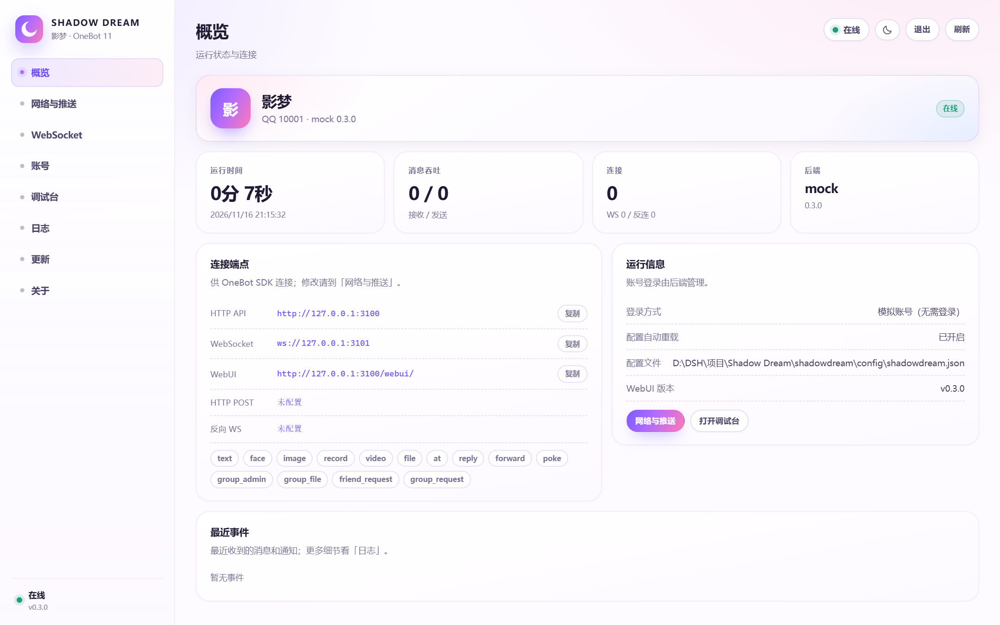
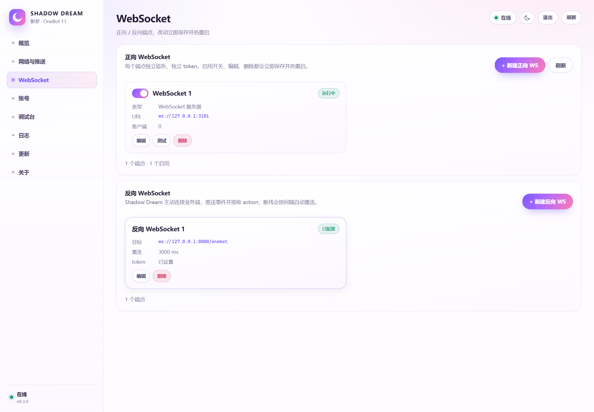

# Shadow Dream · 影梦

> 把 QQ 接进一场 OneBot 11 的影梦。
>
> 当前版本：**0.3.0**

Shadow Dream 是一个新的 QQ → OneBot 11 运行时。它把「协议端」和「传输层」拆开：

- **核心**：完整的 OneBot 11 消息模型、CQ 码、HTTP API、正向 / 反向 WebSocket、HTTP POST、心跳、WebUI 和消息 ID 映射。
- **QQNT 插件**：作为 LiteLoaderQQNT 插件运行在 QQ 主进程里，复用 QQ 自己的登录态与 session，监听消息、调用发送接口。**不修改 `wrapper.node`，不注入 DLL，不接触密码 / 登录密钥。**
- **模拟器**：内置一个会维护好友、群、成员、消息、撤回状态的假 QQ。没有 QQ 环境也能把整条 OneBot 链路跑起来、写测试、接 SDK。

> 0.3 的状态：核心与模拟器已通过自动化测试和真实 HTTP / WebSocket 联调；QQNT 插件按 LiteLoader 生命周期实现，属于**实验性**后端。媒体发送已补齐图片、语音、视频、文件：图片支持 PNG / JPEG / GIF / WebP / BMP，语音支持 SILK / WAV / MP3（自动转 SILK），视频支持 MP4 / MOV，文件不限类型；来源支持本地路径、`file://`、`http(s)://` 和 `base64://`。
>
> 版本变更见 [CHANGELOG.md](CHANGELOG.md)。

---

## 为什么又做一个

NapCat、SnowLuma 这类项目让「QQ → OneBot」变得非常好用，但它们分别依赖修改 `wrapper.node`、注入原生 DLL 或特定版本的 native hook。QQ 一更新，维护成本就会集中到这些二进制边界上；仓库归档后，普通用户也很难自己修。

Shadow Dream 换了一个切面：

| | NapCat / SnowLuma 风格 | Shadow Dream 的 QQNT 后端 |
|---|---|---|
| 运行位置 | 独立进程 + 注入 / 修改 QQ 文件 | LiteLoaderQQNT 插件，跑在 QQ 主进程 |
| 协议实现 | 自己接管 packet / 登录 / 加密 | 复用 QQ 已经登录好的 wrapper 与 session |
| 版本敏感点 | native DLL、offset、wrapper 补丁 | QQ wrapper 的 JS API 形状 |
| 出问题时的定位 | native 崩溃、注入失败 | 插件日志 / Node 异常，通常可读 |
| 核心能力 | 完整 | 0.3 覆盖文本、表情、@、回复、图片、语音、视频、文件、群管理 |

它不是 NapCat 的 fork，也没有复制 NapCat 的代码。参考文件夹里的 NapCatQQ / SnowLuma 只用于理解 NTQQ wrapper 的公开 API 形状和 OneBot 行为；Shadow Dream 的传输层、消息模型、模拟器、插件生命周期都是重新实现的。

---

## 功能

### OneBot 11 传输

- HTTP API：`POST /`、`GET /get_status` 等；支持 `Authorization: Bearer`、`?access_token=`。
- 正向 WebSocket：`api` / `event` / `universal` 三种角色，支持 `X-Client-Role`。
- 反向 WebSocket：自动重连，接收 action 并回包。
- HTTP POST：事件推送，可选 `HMAC-SHA1` 签名（`X-Signature: sha1=...`）。
- 生命周期 / 心跳：`meta_event.lifecycle`、`meta_event.heartbeat`。
- 消息 ID：64 位 QQ 消息 ID ↔ 32 位 OneBot `message_id` 的稳定可逆映射。
- CQ 码：完整转义、解析、序列化；`auto_escape`。
- 错误码：`0 / 1 / 100 / 102 / 103 / 104 / 1401 / 1404 / 1500`。

### WebUI

启动后打开 `http://127.0.0.1:3000/webui/`：

- **概览**：在线状态、QQ 号、消息吞吐、连接端点、能力；
- **网络与反代**：HTTP / 心跳 / HTTP POST / 反向 WebSocket 可视化编辑；
- **WebSocket**：正向 WS 多地址独立管理，每个地址单独启停、编辑、测试、删除；
- **账号**：当前 QQ / 后端 / 登录模式 / 能力；
- **调试台**：任意 action + JSON、mock 消息注入；
- **日志**：级别过滤、搜索、暂停、下载；
- **关于**：版本、配置路径、安全提示。

网络页的「保存并应用」会写入配置文件并立即应用：

- 只改 token、HTTP POST、反向 WS、心跳、日志级别：不重启，直接生效；
- 改 HTTP / 任一 WebSocket 的 host / port：约 100ms 后自动重启传输层，WebUI 会提示新地址；
- 直接修改 `config/shadowdream.json` 也会触发自动重载（文件监听）。

设置了 `webuiToken` 时，QQ 登录页和控制台都会先显示 token 登录页；登录后使用 HttpOnly session cookie。`webuiToken` 为空时沿用 `accessToken`。

> 「账号登录」：mock 显示模拟账号；QQNT 未登录时，WebUI 会通过 QQ 自己的 `NodeIKernelLoginService` 显示登录二维码，扫码后自动切到完整控制台。之前登录过 QQ 的情况下，token 通过后会先用保存账号自动恢复登录，成功就直接进控制台，只有账号下线或恢复失败才显示二维码。二维码由本机 QQ 生成，不经过密码或第三方接口。



正向 WebSocket 独立管理页：



更多界面和自动化接口说明见 [docs/webui.md](docs/webui.md)。Koishi 接入步骤见 [docs/koishi.md](docs/koishi.md)（WSL + Koishi 4.18 实测）。

### 后端

| 后端 | 用途 | 状态 |
|---|---|---|
| `mock` | 无 QQ 开发 / 测试 / 演示 | 可用，带完整假数据 |
| `qqnt` | LiteLoaderQQNT 插件，真实 QQ | 实验性，0.2 |

---

## 一键安装

默认只拉取**精简安装包**（只含构建 / 运行需要的文件，不含文档站 / 知识库、截图和测试），安装目录、插件目录和 WebUI token 直接写在命令里：

```bash
curl -fsSL https://raw.githubusercontent.com/derammeng/Shadow-Dream/main/scripts/bootstrap.sh \
  | bash -s -- \
      --dir "$HOME/ShadowDream" \
      --plugins-dir "$HOME/.local/share/LiteLoaderQQNT/plugins" \
      --webui-token "你的20位token"
```

Windows PowerShell：

```powershell
& ([scriptblock]::Create((irm https://raw.githubusercontent.com/derammeng/Shadow-Dream/main/scripts/bootstrap.ps1))) `
  -Dir "$env:USERPROFILE\ShadowDream" `
  -PluginsDir "C:\path\to\LiteLoaderQQNT\plugins" `
  -WebUiToken "你的20位token"
```

默认不会自动安装 QQ、LiteLoaderQQNT、Xvfb。需要时在 Linux 命令里额外加：

```bash
--install-qq --install-litelloader --install-xvfb
```

需要完整源码时加 `--source full`。参数、镜像和私有仓库说明见 [安装文档](https://derammeng.github.io/Shadow-Dream/guide/install)。

安装完成后：

- Windows 双击 `start-shadowdream.bat`（或运行 `start-shadowdream.bat --check`）；Shadow Dream 跑在 WSL 时用 `start-shadowdream.bat --wsl`；
- Linux / WSL 运行 `bash start-shadowdream.sh`（`--check` 只检查路径）。

Windows 会自动找 QQ、等待 WebUI 并打开浏览器（没检测到 Windows 插件时会自动尝试 WSL）；Linux 还会自动找 LiteLoader profile 和插件，必要时构建/部署，最后打印地址和 token。

检查更新 / 一键更新：

```bash
bash start-shadowdream.sh --check-update
bash start-shadowdream.sh --update
```

Windows 用 `start-shadowdream.bat --check-update` / `--update`。更新会保留配置和插件 data，更新完成后自动重启 Shadow Dream + QQNT。

也可以直接打开 WebUI 侧边栏的「更新」页操作检查、下载和安装。

## 快速开始（不需要 QQ）

要求：Node.js **22+**。

```bash
npm install
npm run demo
```

也可以用 Yarn 1.22：

```bash
yarn install
yarn build
yarn demo
```

Yarn 4 需要 `nodeLinker: node-modules`（不要用 PnP；QQNT 插件发布包依赖 `node_modules` 目录）：

```yaml
# .yarnrc.yml
nodeLinker: node-modules
```

Yarn 会生成 `yarn.lock`；它和 `package-lock.json` 二选一，不要混用。

根目录脚本内部仍会调用 `npm run`（Node 自带 npm），所以 Yarn 只负责安装也可以。想完全不用 npm，可执行：

```bash
yarn workspace @shadowdream/core build
yarn workspace @shadowdream/mock build
node packages/mock/dist/cli.js --no-repl
```

会启动：

```text
HTTP     http://127.0.0.1:3000
WS       ws://127.0.0.1:3001
WebUI    http://127.0.0.1:3000/webui/
账号     10001 mock
```

另开一个终端：

```bash
# 查状态
curl http://127.0.0.1:3000/get_status

# 以“小梦”的身份给机器人发一条群消息（会触发 message 事件）
curl -X POST http://127.0.0.1:3000/webui/api/simulate \
  -H 'Content-Type: application/json' \
  -d '{"message_type":"group","user_id":20001,"group_id":30001,"message":"你好，影梦"}'

# 让机器人往群里发一条 @ 消息
curl -X POST http://127.0.0.1:3000/ \
  -H 'Content-Type: application/json' \
  -d '{"action":"send_group_msg","params":{"group_id":30001,"message":[{"type":"text","data":{"text":"收到 "}},{"type":"at","data":{"qq":"20001"}}]},"echo":"demo"}'
```

CLI 里也可以直接输入：

```text
/friend 20001 你好
/group 30001 20002 大家好
/call get_group_list {}
/status
```

`npm run demo` 默认会读取 `config/shadowdream.json`；第一次启动会自动生成。端口、token、WebUI 开关都在里面。

Linux 的安装、systemd、防火墙和 QQNT 插件步骤单独整理在 [docs/linux.md](docs/linux.md)。服务器没有显示器时用 [docs/headless.md](docs/headless.md) 的 Xvfb 方案。

---

## 快速开始（真实 QQ，Windows）

### 1. 安装 LiteLoaderQQNT

Shadow Dream 的 QQNT 后端是一个 [LiteLoaderQQNT](https://github.com/LiteLoaderQQNT/LiteLoaderQQNT) 插件。先按 LiteLoader 官方文档安装，并确认：

- QQNT 能正常启动；
- LiteLoader 能加载其他插件；
- 启动 QQ 时能看到 LiteLoader 的日志。

### 2. 构建插件

```bash
npm install
npm run build:plugin
```

产物：

```text
packages/qqnt/release/shadowdream/
├─ manifest.json
├─ main.js
├─ backend.js
├─ capture.js
├─ convert.js
└─ node_modules/
   ├─ @shadowdream/core/
   └─ ws/
```

同一目录下还会生成 `packages/qqnt/release/shadowdream.zip`，可直接作为插件包分发。

把整个 `shadowdream` 目录放进 LiteLoaderQQNT 的 `plugins` 目录（插件数据目录以 LiteLoader 的 `LiteLoader.path.plugins` 为准），重启 QQ。

也可以让脚本复制（会先备份旧版本）：

```powershell
powershell -ExecutionPolicy Bypass -File scripts/install-plugin.ps1 -PluginsDir "C:\path\to\LiteLoaderQQNT\plugins"
```

### 3. 登录并确认启动

QQ 登录后，插件会：

1. 捕获 QQ 已加载的 `wrapper.node`；
2. 捕获 QQ 自己创建的 `NodeIQQNTWrapperSession`；
3. 读取当前登录 QQ 号；
4. 启动 OneBot HTTP / WS / WebUI。

在 QQ 的 LiteLoader 日志里应该能看到：

```text
Shadow Dream 已接入 QQNT wrapper
Shadow Dream 已捕获 QQNT session
Shadow Dream 已启动：QQ 123456 昵称
HTTP API  http://127.0.0.1:3000
WebSocket ws://127.0.0.1:3001
WebUI     http://127.0.0.1:3000/webui/
配置      .../plugins/shadowdream/data/config.json
```

打开 WebUI，用任意 OneBot 11 SDK 连接 `http://127.0.0.1:3000` 或 `ws://127.0.0.1:3001`。

更详细的安装、日志和故障排查见 [docs/qqnt-plugin.md](docs/qqnt-plugin.md)。

### 4. 配置文件

插件配置在 LiteLoader 的插件数据目录下的 `config.json`（启动日志会打印完整路径）。第一次启动自动生成，默认只监听 `127.0.0.1`：

```json
{
  "http": {
    "enabled": true,
    "host": "127.0.0.1",
    "port": 3000,
    "accessToken": "",
    "webui": true,
    "cors": ["*"]
  },
  "wsServers": [
    {
      "name": "Koishi",
      "enabled": true,
      "host": "127.0.0.1",
      "port": 3001,
      "path": "/",
      "accessToken": ""
    },
    {
      "name": "备用",
      "enabled": false,
      "host": "127.0.0.1",
      "port": 3002,
      "path": "/alt",
      "accessToken": ""
    }
  ],
  "httpPost": [],
  "reverseWs": [],
  "heartbeat": { "enabled": true, "intervalMs": 30000 },
  "logLevel": "info",
  "backend": { "type": "qqnt" }
}
```

> 暴露到公网前**务必**设置 `http.webuiToken`、`http.accessToken` 和每个 `wsServers[].accessToken`，并把 `host` 改成合适的地址。默认空 token 只适合本机。

---

## 配置速查

| 字段 | 说明 |
|---|---|
| `http.enabled` | 是否启动 HTTP API / WebUI |
| `http.host` / `http.port` | 监听地址；`0.0.0.0` 表示所有网卡 |
| `http.accessToken` | 为空不鉴权；支持 `Authorization: Bearer` 和 `?access_token=` |
| `http.webui` | 是否挂载 `/webui/` |
| `http.cors` | 允许的 Origin，`["*"]` 为全部 |
| `wsServers[]` | 正向 WebSocket 端点数组；每个地址独立启用 / token / 端口 / 路径 |
| `ws.*` | 旧配置兼容字段，等于 `wsServers[0]` 的镜像；新配置建议用数组 |
| `httpPost[]` | 事件推送地址；`secret` 用于 HMAC-SHA1 签名 |
| `reverseWs[]` | 反向 WS 地址；支持 `accessToken`、`reconnectIntervalMs` |
| `heartbeat` | 心跳开关与间隔 |
| `backend.type` | `mock` / `qqnt` |

环境变量也可以覆盖常用项：

```text
FD_HTTP_HOST / FD_HTTP_PORT / FD_HTTP_TOKEN
FD_WS_HOST / FD_WS_PORT / FD_WS_PATH / FD_WS_TOKEN
FD_LOG_LEVEL / FD_BACKEND / FD_CONFIG
```

完整说明见 [docs/configuration.md](docs/configuration.md)。

---

## API 覆盖

核心通用动作（任意后端）：

```text
get_status              get_version_info        get_login_info
get_supported_actions   can_send_image          can_send_record
get_cookies             get_csrf_token          get_credentials
```

QQNT 后端 0.2 支持：

```text
send_private_msg        send_group_msg          send_msg
delete_msg              get_msg                 get_group_list
get_group_info          get_group_member_list   get_group_member_info
get_friend_list         get_stranger_info       get_group_msg_history
get_friend_msg_history  set_group_ban           set_group_whole_ban
set_group_kick          set_group_admin         set_group_card
set_group_name          get_group_at_all_remain get_group_file_system_info
get_online_clients
```

模拟器额外支持 `send_private_forward_msg`、`send_group_forward_msg`、群文件占位、`get_group_honor_info` 等，方便 SDK 做兼容性测试。

完整事件、返回码和动作参数见 [docs/onebot-api.md](docs/onebot-api.md)。

---

## 消息示例

```json
[
  { "type": "text", "data": { "text": "你好 " } },
  { "type": "at", "data": { "qq": "20001" } },
  { "type": "face", "data": { "id": "14" } }
]
```

等价的 CQ 码：

```text
你好 [CQ:at,qq=20001][CQ:face,id=14]
```

`message` 既可以是数组，也可以是 CQ 码字符串；`auto_escape: true` 时字符串按纯文本处理。

---

## 开发

```bash
npm install
npm run build          # core (ESM + CJS) → mock → qqnt
npm test               # core + mock 单测
npm run typecheck
npm run demo
npm run build:plugin
```

目录：

```text
shadowdream/
├─ packages/
│  ├─ core/            OneBot 运行时（传输、协议、WebUI、消息模型）
│  ├─ mock/            模拟 QQ 后端 + 演示 CLI
│  └─ qqnt/            LiteLoaderQQNT 插件后端
├─ config/             演示配置（首次运行生成）
├─ docs/
├─ scripts/
└─ package.json        npm workspaces
```

更细的设计见 [docs/architecture.md](docs/architecture.md)。

---

## 已知限制

- **QQNT 插件是 0.3 实验性后端**：不同 QQ / LiteLoader 版本的 wrapper 字段可能变化；欢迎带日志反馈。
- **媒体发送覆盖图片 / 语音 / 视频 / 文件**：来源支持本地路径 / `file://` / `http(s)://` / `base64://`；语音支持 SILK / WAV / MP3（自动转 SILK），视频支持 MP4 / MOV（封面用内置占位图），文件不限类型。接收侧会把图片 / 语音 / 视频 / 文件转换成对应的 OneBot 段（本地路径 / URL 视 QQ 缓存而定）。
- **媒体上传依赖 QQ 自己的缓存路径 API**（`getRichMediaFilePathForGuild`）：QQ 大版本更新后如果该 API 改名，日志会提示并退回临时目录，需要跟进适配。
- **扫码登录**：未登录时 WebUI 会通过 QQ 自己的登录服务显示二维码；登录过 QQ 后，token 通过会优先自动恢复账号，只有账号下线或恢复失败才显示二维码。
- **群公告、合并转发、表情回应、频道 /  guild 等**尚未实现。
- **平台**：Windows + Node 24 和 Linux 无头运行均已实测；macOS 理论可用，但未实测。
- **合规**：仅用于个人学习与自建机器人。使用前请阅读 QQ 相关协议与当地法律法规；不要用于骚扰、批量营销或其他违规用途。项目与腾讯无关。

---

## Roadmap

- **0.2（已完成）**：一键启动、WebUI 更新页 / CLI 更新、自动恢复 QQ 登录、可选自动安装 QQ / LiteLoader / Xvfb、精简安装包、局域网地址显示、get_msg 1404 修复；
- **0.3（已完成）**：QQNT 图片 / 语音 / 视频 / 文件发送（本地路径 / URL / base64、SILK / WAV / MP3 转码、MP4 / MOV + 内置封面）、WebUI 与文档站改版；
- **0.4**：灰条事件（群成员变动、拍一拍、撤回操作者）、合并转发、`upload_group_file`；
- **0.5**：多账号 / 多后端路由、OneBot 12 适配层；
- 长期：更完整的账号生命周期管理、插件自动更新。

---

## 致谢

- [NapCatQQ](https://github.com/NapNeko/NapCatQQ) 与 SnowLuma：参考了 NTQQ wrapper 的公开接口形状、OneBot 行为边界与 native 捕获思路；本项目未复制其代码。
- [LiteLoaderQQNT](https://github.com/LiteLoaderQQNT/LiteLoaderQQNT)：插件加载器与 API。
- [OneBot 11](https://github.com/botuniverse/onebot-11)：协议标准。
- [Lagrange](https://github.com/LagrangeDev/Lagrange.Core)：NTQQ 协议与数据结构的重要公开参考。

## License

[MIT](LICENSE)
