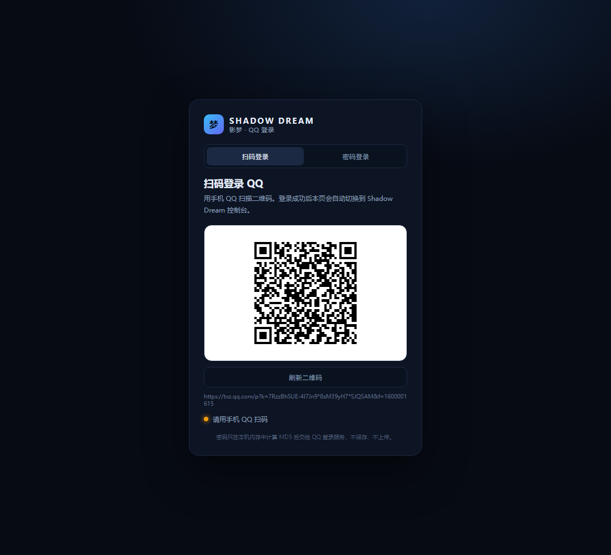

# 无头 Linux QQNT

Shadow Dream 的 `qqnt` 后端跑在 QQ 主进程里，所以「无头」不是把插件做成 CLI，而是让 **QQ 本身**在没有物理显示器的服务器上运行。

Linux QQ 是 Electron 应用，仍然需要 X11/Wayland。服务器上用 **Xvfb** 提供虚拟显示即可：QQ 以为自己有一个窗口，登录服务、LiteLoader 和插件都正常加载，二维码则通过 WebUI 显示。

## 1. 安装依赖

Debian / Ubuntu：

```bash
sudo apt update
sudo apt install -y xvfb libnss3 libnspr4 libasound2t64 libgbm1
```

如果 QQ 还报缺库，用 `ldd /path/to/qq | grep 'not found'` 查。

## 2. QQ 和 LiteLoader

QQ 用 Linux 版 AppImage，解包后目录里应该有 `qq` 二进制：

```bash
chmod +x QQ.AppImage
./QQ.AppImage --appimage-extract
# 得到 squashfs-root/，其中的 qq 就是主程序
```

LiteLoaderQQNT 装到任意目录，设置：

```bash
export LITELOADERQQNT_PROFILE=/opt/QQ/profile
```

把 `shadowdream` 插件放到：

```text
/opt/QQ/profile/plugins/shadowdream/
```

插件配置在：

```text
/opt/QQ/profile/data/shadowdream/config.json
```

## 3. 启动

项目仓库自带脚本：

```bash
QQ_DIR=/opt/QQ/squashfs-root \
LITELOADERQQNT_PROFILE=/opt/QQ/profile \
./scripts/start-qq-headless.sh
```

脚本会：

- 在 `:99` 启动 Xvfb（`1280x800x24`）；
- 设置 `DISPLAY`、`LITELOADERQQNT_PROFILE`；
- 用 `--no-sandbox --disable-gpu --disable-dev-shm-usage --ozone-platform=x11` 启动 QQ；
- QQ 退出时清理 Xvfb。

默认使用 Xvfb 的 unix socket。如果 `/tmp/.X11-unix` 权限不是 `1777`（某些 WSLg 环境会创建成 `777`），脚本会自动退到本地 TCP 显示 `127.0.0.1:99.0`，否则 Xvfb 无法 bind。也可以手动指定：

```bash
XVFB_TRANSPORT=tcp bash scripts/start-qq-headless.sh
```

如果 QQ 缺少运行库（例如非系统目录的解包库），可以额外指定：

```bash
QQ_LD_LIBRARY_PATH=/path/to/libs bash scripts/start-qq-headless.sh
```

第一次启动后打开：

```text
http://127.0.0.1:3000/webui/
```



登录页有两个标签：

- **扫码登录**：显示 QQ 登录服务生成的二维码，手机扫码确认；
- **密码登录**：输入 QQ 号和密码，密码只在服务端内存里计算 MD5 后交给 QQ 的 `passwordLogin`，不保存。

登录成功后自动切换到完整 WebUI / OneBot 服务。

> 密码登录遇到验证码或新设备验证时，WebUI 会显示 QQ 返回的验证链接；这类验证无法也不应该由 Shadow Dream 绕过。

> 如果 3000 端口被占用，先改插件配置里的 `http.port` / `wsServers[].port`，或者停掉旧服务。

## 4. systemd

```ini
[Unit]
Description=Linux QQNT + Shadow Dream (headless)
After=network-online.target
Wants=network-online.target

[Service]
Type=simple
User=qq
WorkingDirectory=/opt/QQ
Environment=QQ_DIR=/opt/QQ/squashfs-root
Environment=LITELOADERQQNT_PROFILE=/opt/QQ/profile
ExecStart=/opt/shadowdream/scripts/start-qq-headless.sh
Restart=on-failure
RestartSec=5
KillMode=mixed

[Install]
WantedBy=multi-user.target
```

## 5. NapCat 的实现给我们的结论

我看了参考目录里的 NapCatQQ 源码，它**没有单独的「反检测模块」**。它的稳定性主要来自架构选择：

- **不注入 DLL、不修改 `wrapper.node`**：插件运行在 QQ 自己的 Electron 主进程里，通过 LiteLoader 的插件生命周期拿到 `wrapper` / session。
- **使用 QQ 官方登录服务**：`NodeIKernelLoginService.addKernelLoginListener()`、`connect()`、`getQRCodePicture()`，二维码由 QQ 登录服务生成；不模拟协议、不伪造签名。
- **真实设备信息**：`initConfig` 使用 QQ 自己的 appid、版本、QUA、数据目录（`packages/napcat-shell/base.ts` 第 99 行附近），不伪造设备指纹。
- **二维码状态机**：`onQRCodeGetPicture` / `onQRCodeSessionUserScaned` / `onQRCodeLoginSucceed` 驱动 WebUI 登录页；未登录时 WebUI 也能打开。
- **headless 在部署层**：源码里没有 Xvfb 逻辑，服务器/Docker 用虚拟显示启动完整 QQ，而不是裁剪 QQ 或走第三方协议。

所谓「反检测」真正有效的部分，是**不额外制造异常**：

1. 进程就是 QQ 自己，网络请求也由 QQ 发出；
2. 登录走官方二维码 / 快速登录，不碰密码和设备锁；
3. 不伪造 appid / QUA / 设备信息；
4. 不做多开、频繁切换账号、异常高频操作；
5. Windows 上 LiteLoader 需要绕过文件校验，这是加载器层面的风险，Shadow Dream 不额外修改 QQ 文件。

Shadow Dream 也采用同样路线，并额外修了两个 Linux 兼容点：

- **不要替换 `process.dlopen`**：Linux QQ 在 wrapper 加载后可能直接退出；
- **不要给原生 session 方法赋值**：只读轮询 + `Module._load` / 直接 `require(wrapper.node)` 兜底。

无头环境推荐直接用 Xvfb，而不是试图让 Electron「完全不要 display」。
