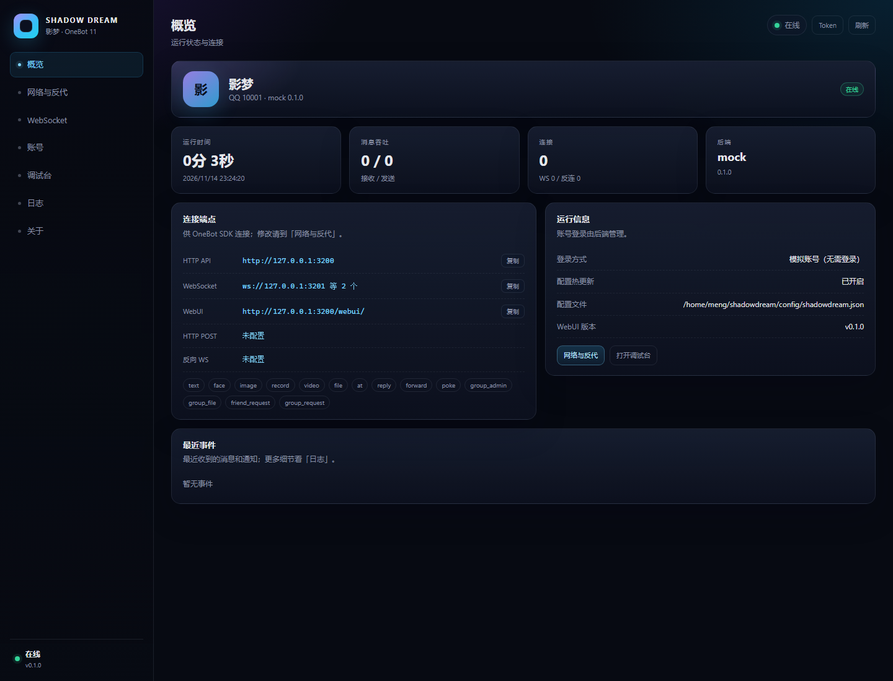
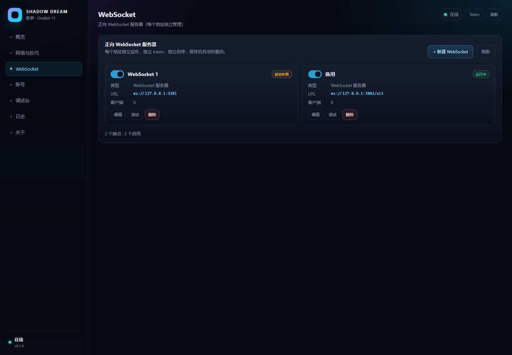

# WebUI



默认地址：

```text
http://127.0.0.1:3000/webui/
```

WebUI 和 HTTP API 共用同一个监听地址，所以改 WebUI 的地址就是改 `http.host` / `http.port`。

## 登录

公网部署请设置 `http.webuiToken`。设置后，QQ 扫码登录页和控制台都会先要求输入 token，登录成功后使用 HttpOnly session cookie，刷新页面不需要重复输入。

```json
{
  "http": {
    "webui": true,
    "webuiToken": "换成你自己的20位随机token"
  }
}
```

- `webuiToken` 为空时沿用 `http.accessToken`；两者都为空则不需要登录，只适合本机；
- token 建议 20 位随机字符串，网络设置页有「随机生成 20 位 token」按钮；
- 登录页不会显示 token，token 只保存在服务端配置；
- cookie：`shadowdream_webui`，HttpOnly、SameSite=Lax、7 天有效；HTTPS 反代下自动加 Secure；
- 右上角「退出」会清除 session；
- 同一 session 在 QQ 登录页和登录后的控制台通用；
- 登录失败按来源 IP 限速，一分钟内最多 10 次。

旧的 `http.accessToken` 仍然用于 OneBot HTTP API；只设置它时 WebUI 也会要求用它登录。

## 页面

### 概览

- 账号头像 / 昵称 / QQ 号 / 在线状态；
- 运行时间、消息收发、WS / 反向 WS 连接数；
- HTTP / 多个正向 WS / WebUI / HTTP POST / 反向 WS 端点；
- 后端能力、配置路径、热更新状态。

### 网络与反代

可编辑：

- HTTP：enabled、host、port、access token、CORS、WebUI 开关；
- 心跳：enabled、intervalMs；
- 日志级别；
- HTTP POST 列表：URL + secret；
- **反向 WebSocket** 列表：URL + token + 重连间隔。

「保存并热更新」：

- 只改 token / HTTP POST / 反向 WS / 心跳 / 日志级别 → 立即应用；
- 改 HTTP / 任一 WebSocket 的 host / port → 约 100ms 后自动重启传输层；
  - 如果 WebUI 端口变了，页面会提示新地址；
  - 如果 token 变了，页面会重新要求输入 token；
- 「从磁盘重载」会重新读取 `config/shadowdream.json`；
- 「重启连接」只重启 HTTP / WS / 反向 WS，不重启进程和后端。

### WebSocket



正向 WebSocket 有独立板块，每个地址一张卡片：

- 显示：名称、启用开关、运行状态、URL、当前客户端数；
- 操作：编辑、测试、删除；
- 新建：名称、host、port、path、独立 token、启用开关；
- 卡片开关会立即保存并热重启；
- 「测试」会从浏览器建立一条 WS，发送 `get_status` 验证连接。

每个端点对应 `wsServers[]` 里的一项。旧配置里的单个 `ws` 会自动迁移成一项。

### 账号

展示：

- QQ 号、昵称、后端、登录模式；
- 后端能力；
- 配置文件路径。

登录说明：

- `mock`：内置模拟账号 10001，无需登录；
- `qqnt`：登录由 QQ 客户端管理，Shadow Dream 只复用已登录的 session，不保存密码、不展示二维码。

真正的「WebUI 扫码登录」需要接入 QQNT 的登录服务，并且会和 QQ 自己的登录窗口竞争；当前版本刻意不做。

### 调试台

- 任意 action + JSON 参数；
- 常用发送示例；
- mock 消息注入（私聊 / 群聊，支持 CQ 码）。

### 日志

- 级别过滤（debug+ / info+ / warn+ / error）；
- 关键字搜索；
- 暂停 / 继续；
- 清空；
- 下载 `.log` 文件。

### 关于

版本、后端、配置文件、热更新状态和安全提示。

## 自动化接口

WebUI 自身也暴露了少量 HTTP 接口，方便脚本管理：

```text
GET  /webui/api/session
POST /webui/api/login       {"token":"..."}
POST /webui/api/logout
GET  /webui/api/overview
GET  /webui/api/config
POST /webui/api/config
POST /webui/api/reload
POST /webui/api/restart
GET  /webui/api/logs?since=0&limit=250
POST /webui/api/action
POST /webui/api/simulate
```

除 `login` / `session` / `logout` 外，其余接口都要求有效的 WebUI session；也兼容 `Authorization: Bearer <webuiToken>` 供脚本调用。

`POST /webui/api/config`：

```json
{
  "config": { "...": "完整配置" },
  "persist": true
}
```

返回：

```json
{
  "status": "ok",
  "retcode": 0,
  "data": {
    "configPath": "...",
    "networkChanged": false,
    "restartScheduled": false,
    "restarted": false
  }
}
```

## HTTP 反向代理（Nginx）

WebUI 和 HTTP API 使用绝对路径 `/webui/`、`/get_status` 等，**建议反代到根路径**，不要挂到 `/qqbot/` 子路径。Shadow Dream 只监听 `127.0.0.1`，由 Nginx 对外：

```nginx
server {
    listen 80;
    server_name bot.example.com;

    location / {
        proxy_pass http://127.0.0.1:3000;
        proxy_http_version 1.1;
        proxy_set_header Host $host;
        proxy_set_header X-Real-IP $remote_addr;
        proxy_set_header X-Forwarded-For $proxy_add_x_forwarded_for;
        proxy_set_header X-Forwarded-Proto $scheme;
    }

    # OneBot 正向 WS（Shadow Dream 的 WS 端口）
    location /onebot/ {
        proxy_pass http://127.0.0.1:3001/;
        proxy_http_version 1.1;
        proxy_set_header Upgrade $http_upgrade;
        proxy_set_header Connection "upgrade";
        proxy_set_header Host $host;
    }
}
```

然后在 Shadow Dream 配置里给 HTTP / WS 都设置 `accessToken`，Nginx 侧再加一层 Basic Auth 或 IP 白名单会更稳。

如果 Nginx 和 Shadow Dream 不在同一台机器，记得把 `http.host` 改回 `127.0.0.1` 并做好防火墙；不要直接把空 token 的 3000 端口暴露到公网。

## 故障排查

### 保存后 WebUI 打不开

如果改了 `http.host` / `http.port`，用新地址打开；端口被占用时旧服务会关闭且新服务启动失败，检查日志。

### 保存后一直要求 token

说明 token 已改变。输入新 token；旧 token 已失效。

### 页面能打开但所有操作 401

session 已过期，或服务端刚改过 `webuiToken`。刷新页面重新输入 token，或点右上角「退出」后重新登录。

### 文件修改没有热更新

- 配置里必须有 `http` 和 `ws` 段；
- 文件必须是合法 JSON（支持 UTF-8 BOM）；
- 后端类型 `backend.type` 不能热切换；
- 修改 `http` / `ws` 监听会触发传输层重启，日志里会有「正在重启 HTTP / WS 传输层」。
